

<a href="https://riftborn.us">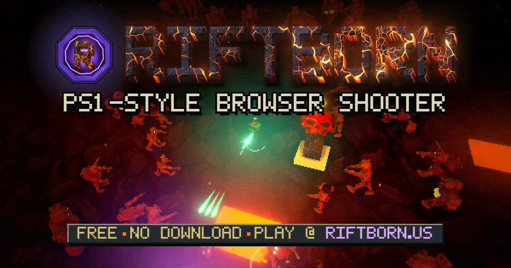</a>

### A PS1-style browser shooter

Free. No download. Plays in your browser on desktop, phone or controller.

## What is Riftborn?

Riftborn is a top-down survival shooter with chunky PS1-era graphics: low-poly worlds, pixelated textures and moody retro lighting. You drop into a rift-torn world, aim and fire by hand, dash through the horde and grow stronger as you level up. Clear each world's kill target, survive its Keeper, then step through the portal into the next world.

- **Aim it yourself.** Every shot is manual, and terrain and cover really block bullets.
- **Build your run.** Level-ups offer upgrade cards. Skull trials, curses and relics let you trade risk for reward.
- **Six worlds, six Keepers.** Each world has its own look, hazards, creatures and boss.
- **Two difficulties.** Normal, or Death mode for players who want the run to hurt.
- **Make it yours.** Unlock characters, badges, dash trails and titles, and track goals in the Journal.
- **Play anywhere.** Mouse and keyboard, a controller, or touch controls on a phone. Sign in to keep your progress across devices and chase the global leaderboard.

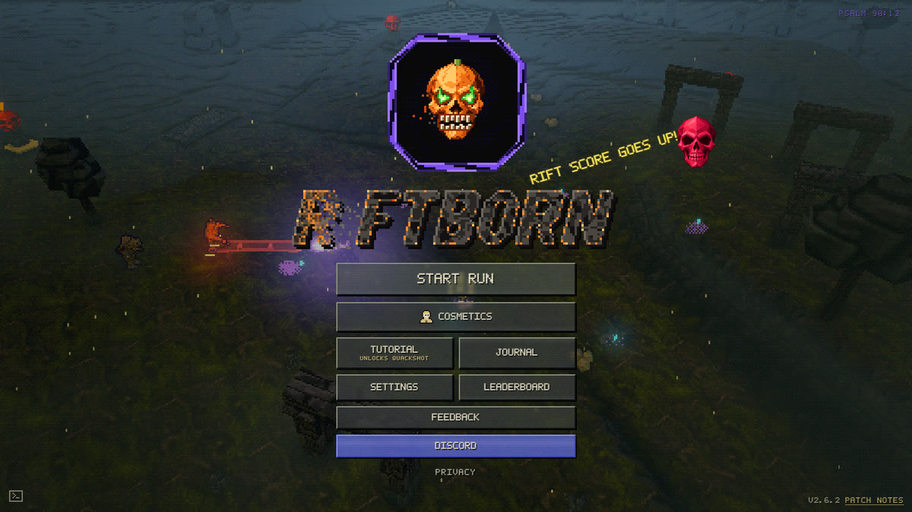

## The worlds

<table>
  <tr>
    <td align="center">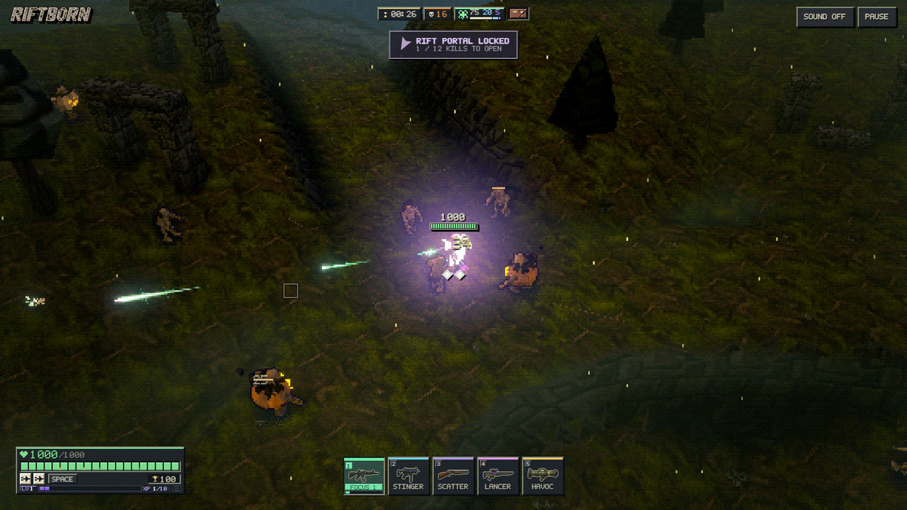 <b>MEADOWS</b></td>
    <td align="center">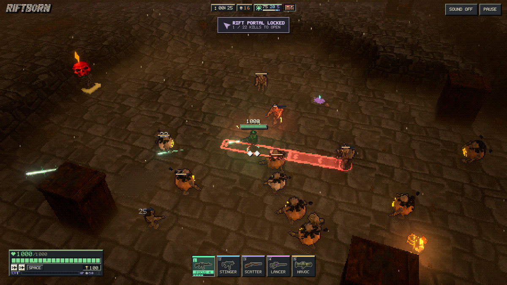 <b>SHATTERED QUARRY</b></td>
  </tr>
  <tr>
    <td align="center">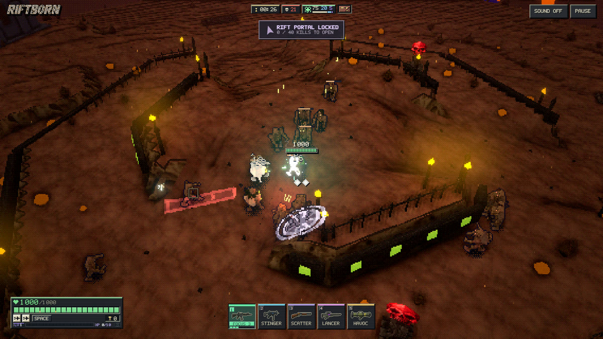 <b>PUMPKIN HILL</b></td>
    <td align="center">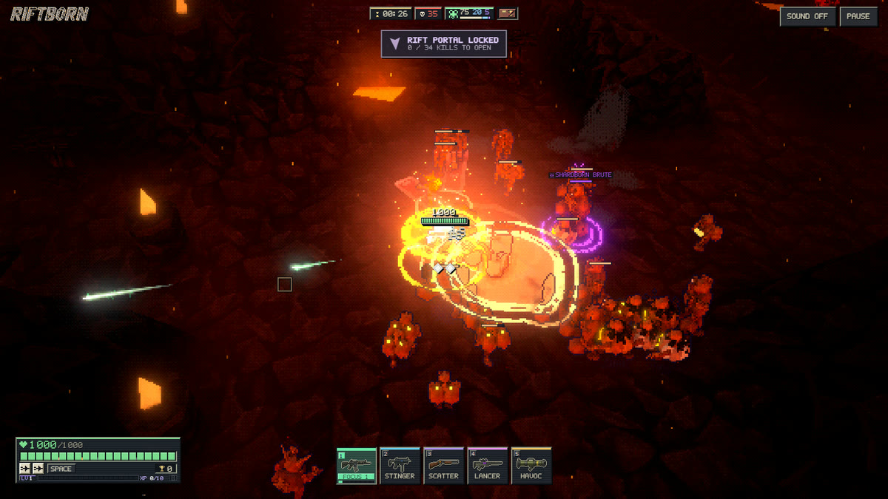 <b>EMBER CALDERA</b></td>
  </tr>
  <tr>
    <td align="center">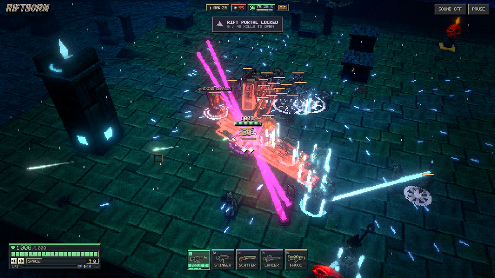 <b>AURORA CITADEL</b></td>
    <td align="center">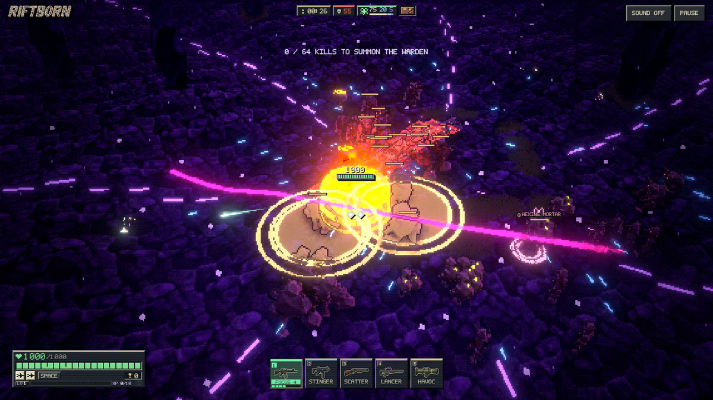 <b>THE VOID CROWN</b></td>
  </tr>
</table>

## The guns

Ten guns, each with its own trick. Carry two into a run, then build around them.

<table>
  <tr>
    <td align="center">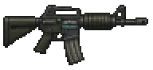 <b>RIFLE</b> Accurate all-round automatic</td>
    <td align="center">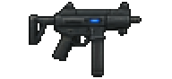 <b>STINGER</b> Huge fire rate, wide spread</td>
    <td align="center">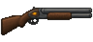 <b>SCATTER</b> Close-range pellet blast</td>
    <td align="center">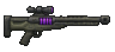 <b>LANCER</b> Long-range piercing rail</td>
    <td align="center">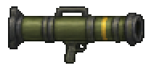 <b>HAVOC</b> Rockets with splash damage</td>
  </tr>
  <tr>
    <td align="center"> <b>GLAIVE</b> A returning crescent disc</td>
    <td align="center">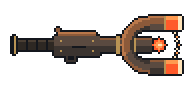 <b>LODESTONE</b> Magnetise foes into each other</td>
    <td align="center"> <b>WICK</b> A burning latch that bursts</td>
    <td align="center">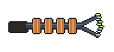 <b>COIL</b> Static that overloads crowds</td>
    <td align="center">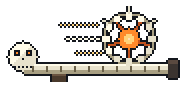 <b>WHEEL</b> A rolling wheel of bones</td>
  </tr>
</table>

## The Keepers

Every world is guarded by a Keeper. Learn its tells, use the terrain and bring it down.

<table>
  <tr>
    <td align="center">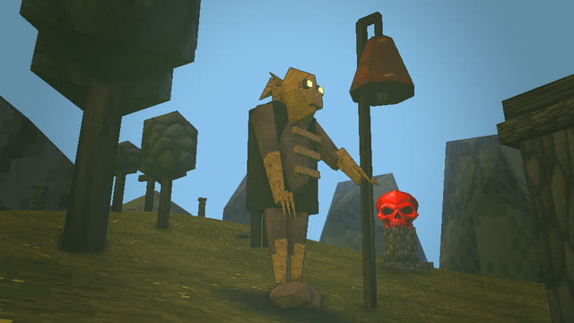 <b>THE BELLWETHER</b> Keeper of the Meadows</td>
    <td align="center">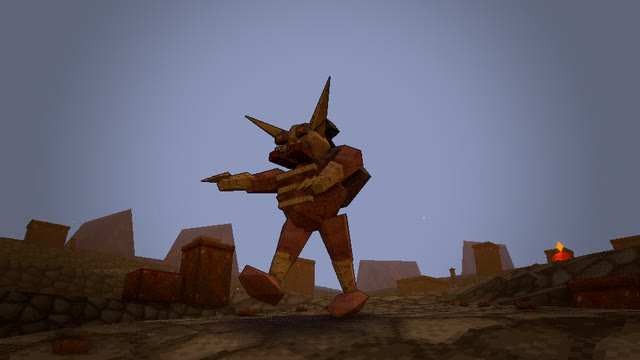 <b>IRON MAW</b> Keeper of the Quarry</td>
    <td align="center">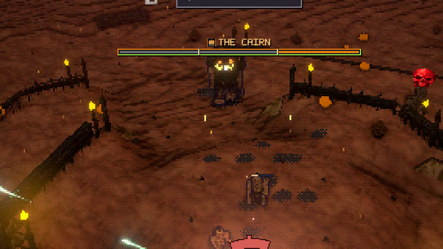 <b>THE CAIRN</b> Keeper of the Spires</td>
  </tr>
  <tr>
    <td align="center">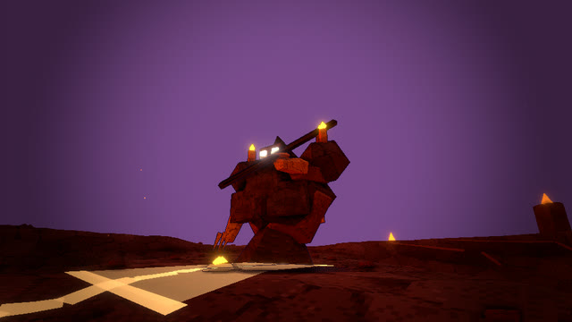 <b>THE CINDER ABBOT</b> Keeper of the Caldera</td>
    <td align="center">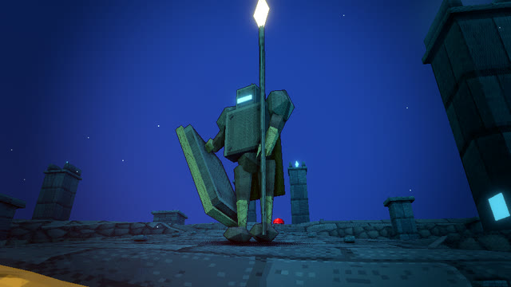 <b>THE CASTELLAN</b> Keeper of the Citadel</td>
    <td align="center">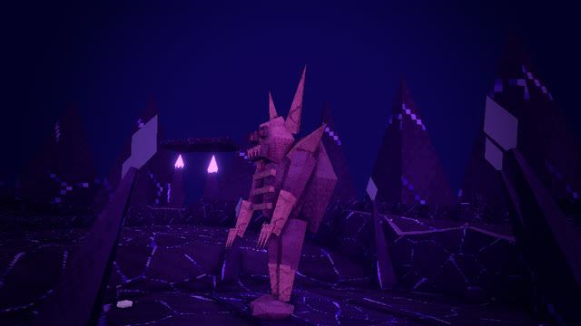 <b>THE RIFT WARDEN</b> Bound to the Crown</td>
  </tr>
</table>

 

**[Play Riftborn at riftborn.us](https://riftborn.us)**

Built with <a href="https://threejs.org">three.js</a> and plain JavaScript. Made by Chandler Crisp.

